<p align="center"></p>

# pyFIB User Guide

pyFIB mills cryo lamellae on the ZEISS Crossbeam 550: you save each site once, draw its patterns, and pyFIB returns to every site, focuses, re-aligns and mills it through the SmartSEM Remote API.

This guide matches **pyFIB v0.55.0**. The screenshots come from a demo session of four sites; their stage values and objective voltages are illustrative.

## Contents

1. [At a glance](#at-a-glance)
2. [Install and launch](#install-and-launch)
3. [The window](#the-window)
4. [Safety rules](#safety-rules)
5. [Start a session](#start-a-session)
6. [Setup and GISDEP tabs](#setup-and-gisdep-tabs)
7. [Correlation tab](#correlation-tab)
8. [ELYMaker tab](#elymaker-tab)
9. [Capture and Positions tabs](#capture-and-positions-tabs)
10. [Rough Mill](#rough-mill)
11. [Prepolish and Polish](#prepolish-and-polish)
12. [How refine finds the site](#how-refine-finds-the-site)
13. [How pyFIB takes one clean frame](#how-pyfib-takes-one-clean-frame)
14. [Tools tab](#tools-tab)
15. [Reading the Log and the report](#reading-the-log-and-the-report)
16. [Command line](#command-line)
17. [Troubleshooting](#troubleshooting)

## At a glance

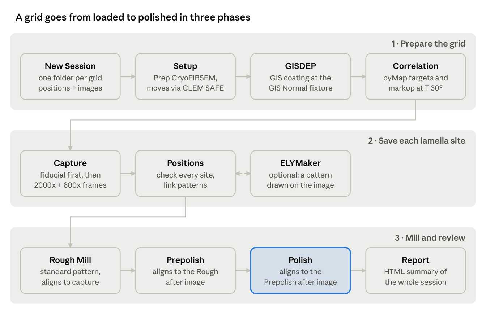

One session covers one grid. Prepare it, save every lamella site once, then run Rough Mill, Prepolish and Polish as three batches; each stage aligns to the after image the stage before it saved. ELYMaker is optional: without it every site gets the standard pattern.

## Install and launch

pyFIB runs on the microscope PC (Windows, Python 3.9.13) beside SmartSEM and SmartFIB. Every command below is typed in a command prompt opened in the pyFIB folder, the one that contains `smartfib_executor\`.

1. Get the code: clone this repository or unzip a release into its own folder. Keep older versions in their own folders; nothing is shared between them except what you copy.
2. Install the packages once per Python install:

   ```
   python -m pip install -r requirements.txt
   python -m pip install -r requirements-pymap.txt
   ```

   The first line is everything the pyFIB window and the milling commands need. The second line is only for the Correlation tab (pyMap). Run it again when a release note says pyMap's packages changed.
3. Check the API connection. This script only reads; it moves and sets nothing:

   ```
   python test_scripts\api_check.py
   ```

   It lists other Python processes holding a SmartSEM connection (for example a running serialFIB), the pywin32 version and the win32com `gen_py` cache. If it reports pyFIB's API object as early-bound through a `gen_py` wrapper made by another program, close that program, delete the cache folder the script prints, and run it again (`--late` forces the late-bound connection for comparison).
4. Start the GUI:

   ```
   python -m pyfib ui
   ```

   The window opens on the Setup tab in **dry run** with a fresh session. Add `--positions-file <path>` to open a particular session instead.

If a button fails, pyFIB shows the error and keeps running. Details go to the Log tab and to `logs\pyfib_gui_errors.log`; a hard crash inside the ZEISS API leaves a stack in `logs\pyfib_faults.log`, and pyMap keeps its own `logs\pymap.log`. If pyFIB ever ends without closing, it says so the next time it starts. **Run › Open logs folder** opens the folder; send all of it with a bug report.

## The window

The window has the same frame on every tab: the session along the top, the tabs down the left in the order you use them, and ARM at the bottom left. The numbers match the screenshot below.

| # | Part | What it is for |
| --- | --- | --- |
| 1 | Logo | Hover for the pyFIB version. |
| 2 | Positions file, Browse… | The `positions.json` every tab works on. |
| 3 | Session: New Session, Load Previous… | Start a fresh session or reopen an old one; the session's folder name shows on the right. |
| 4 | Tabs | Setup → GISDEP → Correlation → ELYMaker → Capture → Positions → Rough Mill → Prepolish → Polish, then Tools and Log. |
| 5 | ARM | Dry run until pressed; red ARMED (instrument live) while on. |
| 6 | Status bar | The last message: what just ran, or why it did not. |

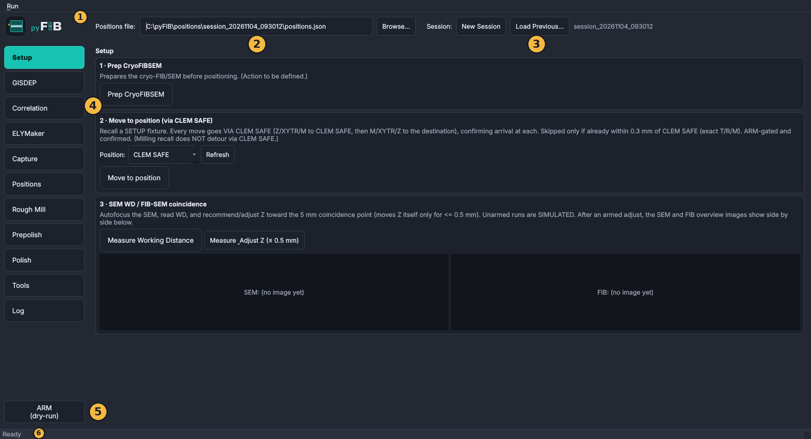

*The pyFIB window, here on the Setup tab. Numbers match the table above.*

Command output streams to the **Log** tab, but the manual milling buttons keep their own tab on screen while they run.

## Safety rules

Nothing reaches the microscope until you press **ARM**, and even armed, pyFIB refuses any step whose starting state it cannot confirm. The ARM button sits at the bottom of the left column on every tab.

| Mode | Button shows | What a button press does |
| --- | --- | --- |
| Dry run (start-up default) | ARM (dry-run), grey | Prints the plan to the Log. No stage move, no beam change, no milling. |
| Armed | ARMED (instrument live), red | Runs the command for real. Most armed buttons ask you to confirm first. |

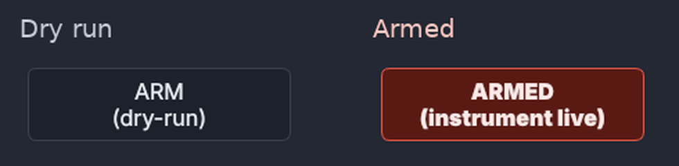

The GISDEP tab follows the same toggle. Its own label reads **MOCK · offline** when no instrument is connected.

**What pyFIB checks for you**

- **2° tilt limit.** A milling batch only visits positions recorded within 2° of the live tilt and of the previous site. The others are listed before anything moves; you OK the list or nothing starts.
- **No stage move while milling.** Before every recall pyFIB reads SmartSEM's milling state; if it still reads milling, pyFIB waits until "not milling" has held for 10 s.
- **Milling must stay finished.** After SmartSEM first reads "finished", it must keep reading finished for the **Confirm done** window (default 20 s) before the site counts as done.
- **Beam shift back to zero, never during a mill.** FIB beam shift is zeroed before the first site and after every site, including after an error. pyFIB checks first that SmartSEM does not indicate milling: if a site ends while its pattern is still running (a mill timeout, an error, Ctrl+C), the beam shift is left alone and reset before the next stage move instead. The Log then says `[beam-shift] *** NOT reset …`.
- **Small, checked stage corrections.** Refine moves the stage at most 100 µm per axis, only at R 12° and tilt −1 to 31°, and undoes the move unless the drift halves.
- **Setup moves go through CLEM SAFE.** Z goes first on the way to CLEM SAFE and last on the way to the destination.
- **Polish never lands blind.** In Prepolish and Polish, a site whose refine failed is never milled, and a site without the previous stage's after image is listed and skipped.
- **One fresh frame per image.** Every image pyFIB measures or saves is a single new frame; a stale or repeated frame is refused (see [How pyFIB takes one clean frame](#how-pyfib-takes-one-clean-frame)).
- **Manual buttons refuse during milling.** Go to, Align, Push pattern and Record after image do nothing while SmartSEM indicates milling.

**What you must do**

- Do not change the stage, magnification, scan speed or imaging mode in SmartSEM while a pyFIB step is running.
- Always run a batch once in dry run and read the plan in the Log before arming it.
- Watch the first site of every armed batch from recall to after image.
- Re-use an old session only for the grid it was captured on (see [Start a session](#start-a-session)).

> **Note:** the milling tabs have no Stop button for a running batch (a second press only says "A command is already running"). Closing pyFIB while a command runs asks first: **Keep pyFIB open** (the default), **Close when it finishes** (nothing new starts, and pyFIB closes itself once the command has ended), or **Kill it now…**, for a command that hangs. Kill asks again, because pyFIB does not abort milling: stop a running pattern in SmartFIB yourself and check SmartSEM afterwards. Closing while GISDEP runs a step is refused. A batch started from the command line stops with Ctrl+C, and the beam shift is still reset. If the pyFIB window itself dies during a batch (a crash, Task Manager), the batch finishes the site it is milling, including the after image and the beam-shift reset, and stops before the next stage move. A site whose mill had not started yet is not started; `runs\run_<time>.log` in the session folder has the rest of its output.

## Start a session

A session is one folder holding one `positions.json` and everything made from it; start a new one for every grid you load. pyFIB proposes a new session each time it opens, named by the time:

```
<pyFIB folder>\positions\session_<YYYYMMDD_HHMMSS>\positions.json
```

Nothing is written until the first capture, so the status bar may say "Could not load positions: No such file" until then. That is normal.

- **New Session** starts a fresh, empty file at any time and clears every table.
- **Load Previous…** (or **Browse…**) opens an existing `positions.json`. Its stage coordinates belong to the grid and stage baseline it was captured on. Recalling them on a different grid or after re-loading can drive the stage to the wrong place, so use it only to continue work on the same, untouched grid.

What ends up in the session folder:

| Path | What it holds |
| --- | --- |
| `positions.json` | Every position: stage X, Y, Z, R, M, tilt, FIB objective voltage, magnification, pixel size, field of view, fiducial, linked pattern and latest after images. |
| `positions.json.prev` | The version of `positions.json` before the last save. |
| `images\<name>.bmp` | The 2000x reference frame from Capture, plus the 800x coarse frame. |
| `images\<name>_<n>-<stage>_<time>.bmp` | After-mill images: `_1-rough_`, `_2-prepolish_`, `_3-polish_`. A `.bmp.json` beside each records the imaging read-backs. |
| `patterns\` | Patterns authored per position in ELYMaker, with their ready markers. |
| `runs\run_<time>.json` | One record per armed milling batch: what happened at every site. |
| `clem\` | Correlation overviews, pyMap targets, `pyfib_clem_plan.json` and the markup layouts. |
| `report_<time>.html` | The session report and its positions map files. |

## Setup and GISDEP tabs

Setup gets the instrument and stage ready; GISDEP coats the grid. Both move the stage only through CLEM SAFE, and both are dry runs until armed.

### Setup tab

1. **Prep CryoFIBSEM** readies the instrument for sample insertion. In order: SEM EHT off (and confirmed off), column chamber valve closed, FIB gun valve closed (the FIB stays on), SEM set to 2.00 kV and 20 pA, stage to **Cryo Insertion** via CLEM SAFE, FIB probe reported. If EHT never confirms off, it stops before touching a valve or the stage. (The card still reads "Action to be defined"; the sequence above is what the button runs.)
2. **Move to position (via CLEM SAFE)** recalls a setup fixture: CLEM SAFE, Cryo Insertion, Cryo Removal, Grid1 Milling, Grid1 GIS Normal or Grid2 GIS Normal. The route is Z, then X/Y/T/R, then M to CLEM SAFE; then M, X/Y/T/R and Z last to the destination, confirming arrival at each. It skips CLEM SAFE only when the stage is already within 0.3 mm of it with exact T, R and M. **Refresh** reloads the list.
3. **SEM WD / FIB-SEM coincidence.** **Measure Working Distance** autofocuses the SEM, reads the WD and recommends a Z change toward the 5 mm coincidence point. **Measure_Adjust Z (≤ 0.5 mm)** also makes that Z move, but only when it is 0.5 mm or less. After an armed adjust, SEM and FIB images appear side by side so you can confirm both beams see the same spot.

The annotated screenshot in [The window](#the-window) shows the Setup tab.

### GISDEP tab

GISDEP is the bundled cryo GIS deposition tool; its arm state follows pyFIB's ARM button, and its own **STOP** halts it. The live-state panel shows each GIS needle (Parked or Inserted), each valve, stage Z and working distance.

The live state is read from the microscope only while this tab is on screen. While a pyFIB command or batch runs, the panel is greyed out and reads nothing; a pyFIB command will not start while GISDEP is running a step. If the tab is opened for the first time during a command, it opens a few seconds after the command has finished.

- **Full run:** pick Grid, Port (GIS1 or GIS2) and Dwell (s), then **Run full sequence**. It goes to the grid via CLEM SAFE, autofocuses, steps Z to 5.5 mm WD, autofocuses again to confirm, then deposits. Each step asks for confirmation when armed.
- **Step by step:**
  1. **Go to Grid 1 / Go to Grid 2**: to CLEM SAFE (Z first, then X, Y, T, R), verify, then to the grid (X, Y, T, R first, then Z). M never moves.
  2. **Check working distance** (read-only, optional autofocus), then **Move −Z / Move +Z** by the step in µm, or **→ 5.5 mm WD (one step)**. Limits: target 5.5 mm, Z between 20 and 40 mm, needles parked.
  3. **Run deposition** with the chosen port and dwell.

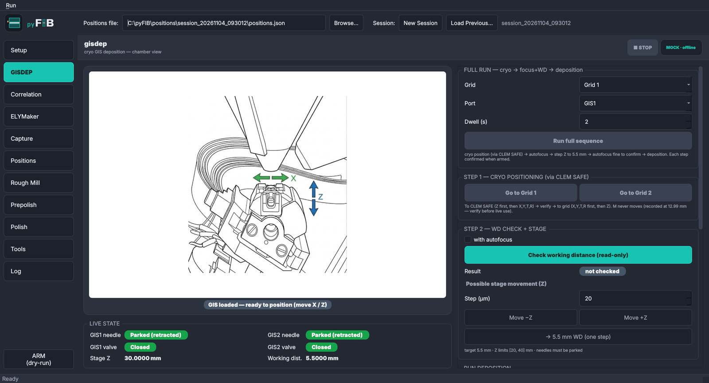

*The GISDEP tab. Here it runs on its mock because no instrument is connected.*

## Correlation tab

The Correlation tab turns confocal targets into marked spots on the grid: pyMap (right pane) registers the confocal to a FIB overview, and pyFIB (left pane) checks the targets and mills markup trenches beside them. Everything here happens at SEM normal, tilt 30° and R 12°, and pyFIB does not yet drive to a target on its own.

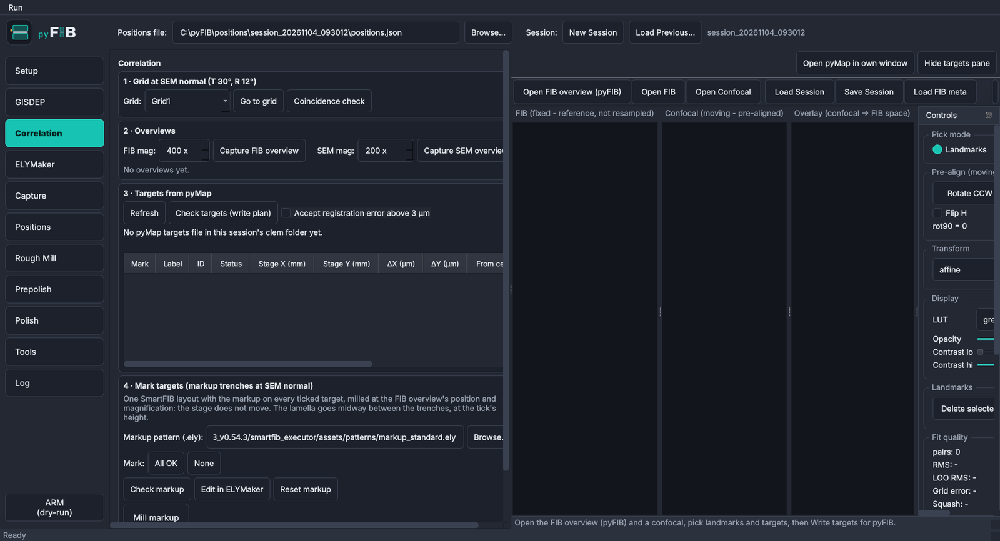

1. **Grid at SEM normal.** Pick Grid1 or Grid2 and press **Go to grid**: the setup move via CLEM SAFE to that grid's GIS Normal fixture. **Coincidence check** autofocuses the SEM, reads the WD and recommends a Z move toward 5 mm; it moves nothing.
2. **Overviews.** **Capture FIB overview** at 400x (beam shift is zeroed first) and **Capture SEM overview** at 200x. Both save into `<session>\clem\`, never move the stage, and refuse unless tilt is 29–31°, R is 12° ± 1° and SmartSEM is not milling.
3. **Register in pyMap** (right pane):
   1. **Open FIB overview (pyFIB)**, then **Open Confocal**.
   2. Click matching landmark pairs in the two images; use Rotate CCW or Flip H if the confocal arrives turned.
   3. Check **Fit quality**: pairs, RMS and leave-one-out (LOO) RMS. Add or delete landmarks until LOO RMS is small.
   4. Pick the targets on the overlay and press **Write targets for pyFIB**.

   **Hide targets pane** gives pyMap the whole tab while you register; **Open pyMap in own window** moves it to a second monitor. pyMap only reads and writes files; it never touches the microscope. Starting a new session keeps pyMap's images and landmarks; open the FIB overview from the new session, and re-pick or clear landmarks picked on the old overview, before writing targets.
4. **Targets from pyMap.** **Refresh** loads pyMap's newest targets file and lists each target's stage X/Y, offset from the overview centre, status and reasons. **Check targets (write plan)** writes `clem\pyfib_clem_plan.json`. A registration error above 1 µm is warned; above 3 µm the targets are refused unless you tick **Accept registration error above 3 µm**, which is recorded in the plan. A grid holds at most 30 targets.
5. **Mark targets.** Tick the targets to mark (**All OK** or **None**), then:
   1. **Check markup**: a dry run that writes the layout and prints the plan.
   2. **Edit in ELYMaker** (optional): opens the layout over the FIB overview with the targets drawn in. A saved edit is milled as saved; **Reset markup** regenerates it.
   3. ARM, then **Mill markup**: one SmartFIB layout with the markup pattern (Markup_Standard) on every ticked target, milled at the overview's position and magnification.

   The stage never moves for markup, so it must still be where the overview was taken: within 1 µm in X/Y/Z/M, 0.05° in T/R and 1% in magnification. Every shape stays at least 5 µm inside the field and 2 µm from any target. Each lamella goes midway between its two trenches, at the height of the tick.

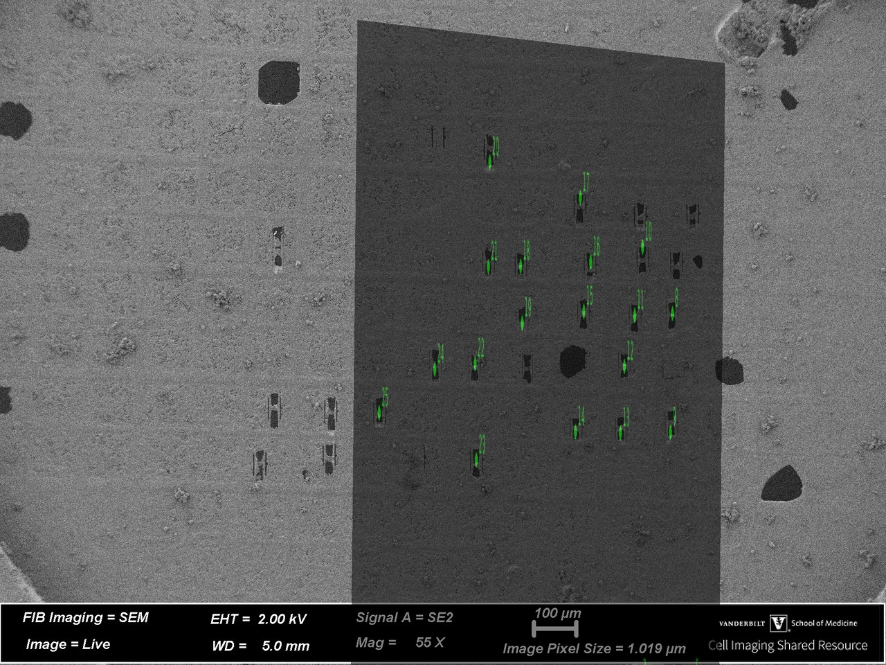

*A registered confocal overlay on an SEM overview: the green spots are the fluorescent targets pyMap passes to pyFIB.*

After marking, tilt to the milling angle, find the trenches in the FIB image and save each lamella site on the Capture tab.

## ELYMaker tab

ELYMaker (bundled as 0.9.1+pyfib.1) draws the SmartFIB `.ely` patterns pyFIB mills. Use it two ways:

- **For one position:** on the Positions tab, select the site and press **Author pattern…**. ELYMaker opens with that site's reference image placed to scale, its centre at the layout origin, and any pattern already linked to the site. This is the usual way.
- **On its own:** **File › Open .ely…**, **File › Load FIB image…** (asks for the pixel size), or **Pattern › New lamella…** (Ctrl+L) to start from the lamella template.

The canvas shows the image with the shapes coloured by probe current (legend bottom left). The right panel holds the drawing **Tools** (Select, Pan, Rectangle, Rounded box, Polygon, Arc, Text, Undo, Redo, Duplicate, Round corners, Mirror X, Mirror Y), the **Properties** of the selected shape (position, size, angle, depth, probe, recipe) and **New-shape defaults**. The **Validation** strip under the canvas must read "OK: no issues" before you save.

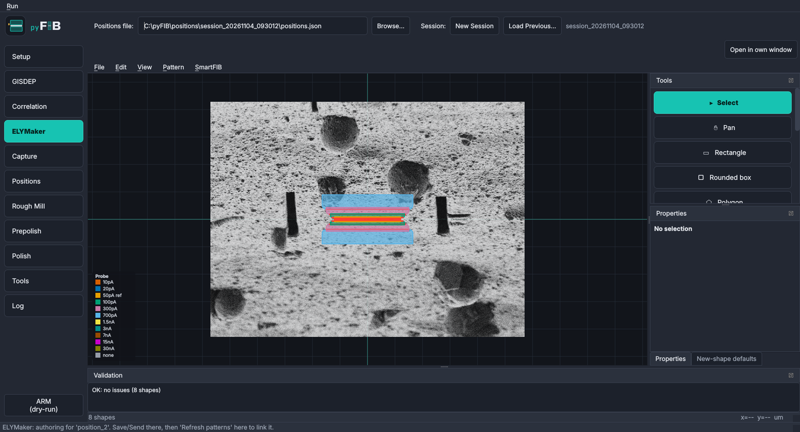

*Author pattern… for position_2: the standard lamella pattern placed to scale on the site's 2000x reference image, between the two fiducials.*

To link an authored pattern to its position:

1. In ELYMaker choose **SmartFIB › Send pattern to SmartFIB**. In authoring mode this writes the pattern into `<session>\patterns\` with a ready marker; it does not load anything into SmartFIB or start milling. **File › Save** alone writes the file without the marker.
2. Back on the Positions tab, press **Refresh patterns**. The site's **ELY** column changes to "yes".
3. Rough Mill now mills this pattern at that site instead of the standard pattern. Prepolish and Polish never use authored patterns. If the `.ely` was edited after it was marked ready, the batch warns.

**Rotated rectangles follow SmartFIB.** SmartFIB rotates a rectangle about its centre, counter-clockwise for a positive angle (measured on the Crossbeam 2026-10-20 with two test bars). Since v0.54.3, ELYMaker, its preview and validation, and the session report all draw rotation the same way, so a rotated trench lands where it is drawn.

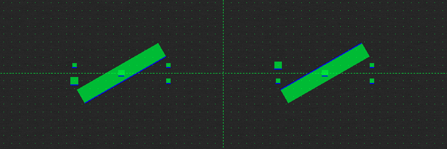

*The rotation test in SmartFIB (20 Oct 2026): both test bars turn counter-clockwise about their own centres.*

**Open in own window** moves ELYMaker to a second monitor; close that window to bring it back.

## Capture and Positions tabs

Capture saves one lamella site: where the stage is, how the FIB was focused, and the reference images every later step aligns to. Mill the fiducial first, so it is in the reference image.

**Capture tab fields**

| Field | Default | Meaning |
| --- | --- | --- |
| Name | position_1 | Counts up after each successful armed capture. |
| FIB magnification | 2000 | Magnification of the reference frame. |
| Grab W × H | 1024 × 768 | Pixel size of the saved frame. |
| Image dir | (session `images\`) | Optional other folder. |
| Record tilt | on | Saves the stage tilt; recall restores it. |
| Also capture 800x image | on | A second, wider frame that refine falls back to. |
| Fiducial | number, left, #1 | Kind (numbered 1–30 or square), side and number for **Mill fiducial here**. |
| Record on capture | none | Which fiducial this capture records; set for you after a fiducial is milled. |

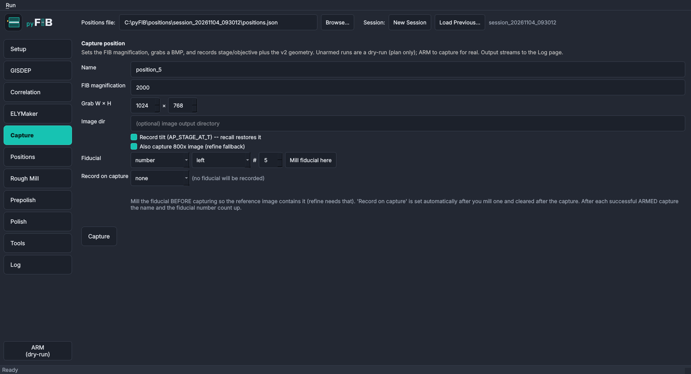

**Saving a site**

1. In SmartSEM, drive to the site at the milling tilt, centre it in the FIB image and focus the FIB (or use **FIB autofocus** on the Tools tab).
2. Set the fiducial kind, side and number, ARM, and press **Mill fiducial here**. It mills at the current stage position at the capture magnification and warns if the fiducial will not fit in the field of view.
3. Press **Capture**. pyFIB switches to FIB imaging if needed, sets the magnification, grabs one fresh frame, then the 800x frame, and records stage X, Y, Z, R, M and tilt, objective voltage, pixel size, field of view, scan rotation and beam shift. Scan rotation and beam shift should both read about zero. Capturing over an existing name asks first.
4. Move to the next site and repeat. The name and fiducial number have already counted up.

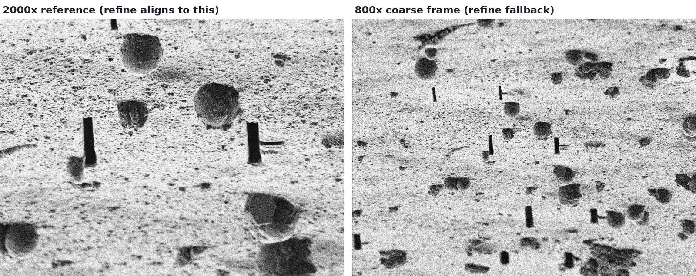

*One capture saves both frames. The two dark bars are the fiducials milled before capture.*

Capture refuses rather than save a doubtful frame: a stale, repeated or too-short frame stops it with a message in the Log.

**Positions tab**

The table lists every saved site: Name, Mag (x), Obj (V), X/Y/Z (mm), px (nm), FOV w (µm), ELY (authored pattern linked) and Fid (fiducial side and number). Select a row to see its reference image.

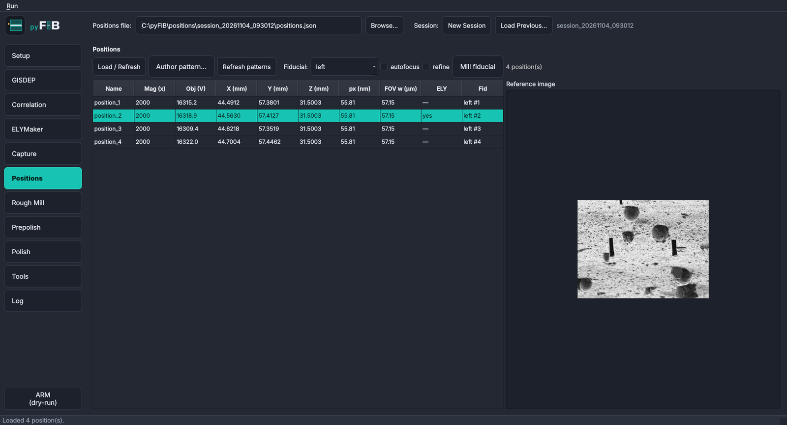

- **Author pattern…** opens the site in ELYMaker (previous section); **Refresh patterns** links saved patterns.
- **Mill fiducial** mills a fiducial at a saved site, after moving there. The reference image was taken without it, so re-capture the site afterwards under the same name; milling before capture avoids this.

## Rough Mill

Rough Mill visits every ticked position in turn and mills it: the standard pattern, or the site's own authored pattern if it has one. It aligns each site to its capture image and saves an after-mill image that Prepolish will align to.

**Settings** (the same row appears on Prepolish and Polish)

| Control | Default | What it does |
| --- | --- | --- |
| Standard pattern (.ely) | (none) | The pattern milled at every ticked site without an authored pattern. |
| Wait | auto | How "milling finished" is detected. auto = SmartSEM's FIB mode changes or the beam reads blanked, whichever comes first. |
| Move | movestage | How the stage is recalled. Leave on movestage. |
| AF scan rate | 8 | Scan speed of autofocus frames (−1 = as set in SmartSEM). |
| Refine scan rate | 8 | Scan speed of refine frames. Prepolish and Polish use 3. |
| Confirm done (s) | 20 | How long "finished" must hold before the site counts as done (10–120 s). |
| Mill timeout (min) | 240 | The longest one site may mill (10–1440 min). Set it well above the time SmartFIB shows for the pattern. A site that runs longer ends as an error; pyFIB does not stop the pattern and leaves the beam shift alone while it runs. |
| Continue on error | off | Off: the batch stops at the first error. On: it moves to the next site. |
| Refine may move stage | on | Lets refine make one X/Y stage move (≤ 100 µm) when drift exceeds the 10 µm beam-shift window. |
| Skip site if refine fails | off | On: a site whose refine failed is not milled. Always on in Prepolish and Polish. |
| After-mill image | on | One fresh FIB frame per site after milling, saved and recorded. Adds one frame of ion dose per site. |

Each row has three ticks: **Mill**, **AF** (FIB autofocus first) and **Refine** (align first), with **All / None** buttons per column. The **Status** column updates live: Autofocus…, Refine…, Milling…, Done, Error, or Skipped with the reason. **Align to** shows the image refine will use and **After image** the latest one saved.

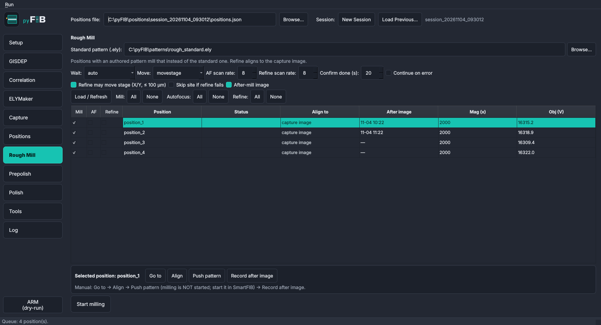

**Running a batch**

1. Choose the standard pattern, press **Load / Refresh**, and tick Mill, AF and Refine for each site.
2. With ARM off, press **Start milling**. The Log prints the whole plan and nothing moves. Read it: sites, order, pattern per site, tilt check.
3. ARM and press **Start milling** again. If any site is more than 2° from the live tilt (or from the site before it), a dialog lists them; OK mills the rest, Cancel moves nothing.
4. Watch the first site through to its after image. Status reads Done for each finished site.

**What happens at each site**

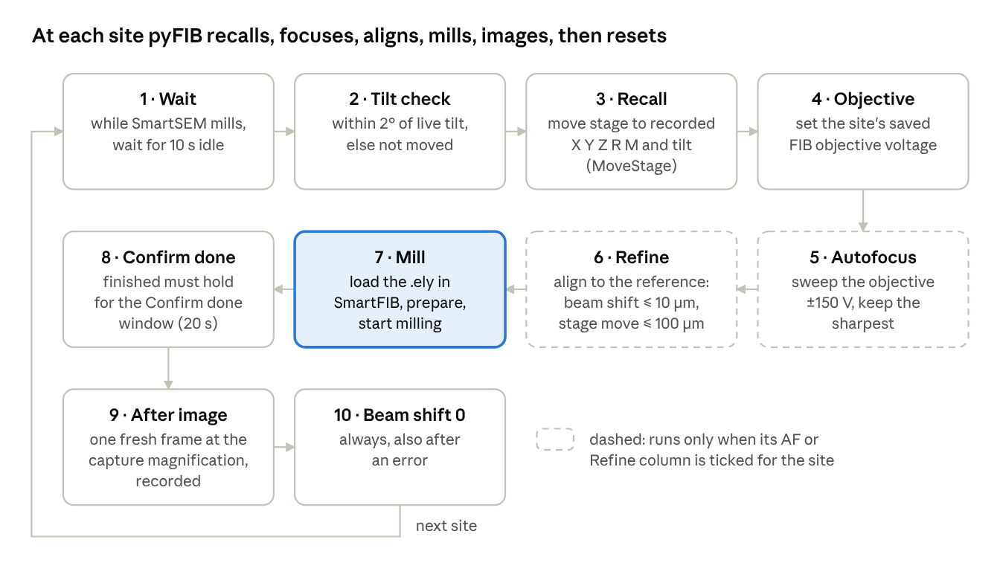

Prepolish and Polish run the same ten steps; only the pattern and the refine reference change. Steps 9 and 10 happen before the stage moves on, so the after image is taken with this site's correction still applied.

## Prepolish and Polish

Prepolish and Polish thin each lamella with their own pattern and align each site to the previous stage's after image, so the new cut lands on the old one. They work exactly like Rough Mill, with four differences:

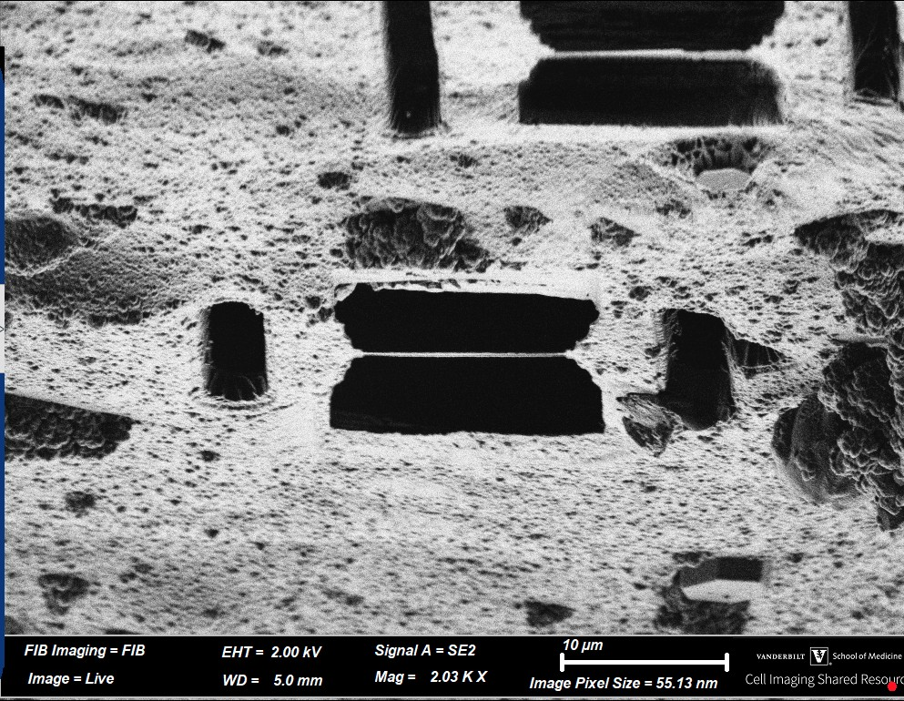

*A milled site in the FIB. The after image of each stage looks like this, and the next stage aligns to it.*

- **One pattern for every site.** Authored rough patterns are never milled here.
- **Different reference.** Prepolish aligns to the latest Rough Mill after image, Polish to the latest Prepolish after image. **Align to** shows it (for example "rough 11-04 10:22") or **missing** in red. Missing sites are listed when you start and are not milled.
- **Refine at scan speed 3.** A speed-3 refine that cannot correlate is retried once at speed 8, then at 800x (see [How refine finds the site](#how-refine-finds-the-site)).
- **Skip site if refine fails** is always on. A site ticked for Mill but not Refine gets a warning: its pattern would land at the recalled position with zero beam shift, not on the previous milling.

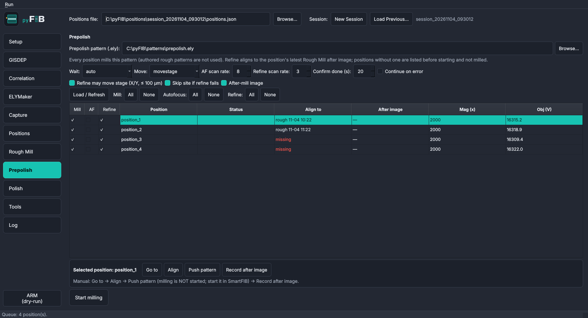

### Manual buttons, one site at a time

All three milling tabs have the same four buttons for the selected row. Use them to redo or check one site. Each asks for confirmation when armed and refuses while SmartSEM indicates milling.

1. **Go to**: zero the FIB beam shift, move the stage to the site (recorded tilt), set its objective voltage and FIB magnification.
2. **Align**: refine to this stage's reference (capture image or previous after image). The beam-shift correction stays on for milling.
3. **Push pattern**: load and prepare this stage's pattern in SmartFIB. Milling is **not** started. Check the pattern in SmartFIB and start it there.
4. **Record after image**: once SmartFIB has finished, grab one FIB frame at the capture magnification and record it as this stage's after image.

If you press Record after image while SmartFIB is still milling, it refuses and changes nothing:


## How refine finds the site

Refine compares a live FIB frame with the site's reference image and moves the beam (and if needed the stage) until they line up, so the pattern lands where it was planned. In Prepolish and Polish it starts at scan speed 3 and falls back twice before it gives up.

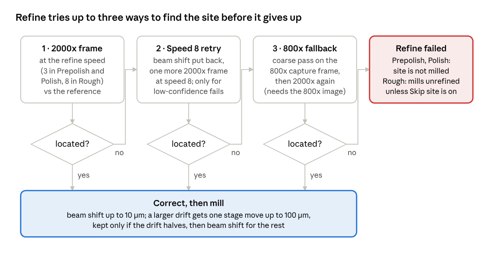

The speed-8 retry only follows a 2000x attempt that could not lock on (Log message starting Low confidence, Unreliable, Residual or Stopped after) and that did not involve the stage. Rough Mill already refines at speed 8, so it goes straight to the 800x fallback. The scan speed is restored when refine finishes. Every refine is written to the run log with its scan speed, whether a fallback ran, and how long it took.

## How pyFIB takes one clean frame

Every image pyFIB measures or saves (capture, refine, autofocus, after image, overviews) is one new, complete frame taken by the same routine. An old frozen image, or a frame cut short by a scan change, would mislead refine or the next stage, so pyFIB checks each one and refuses it when in doubt.

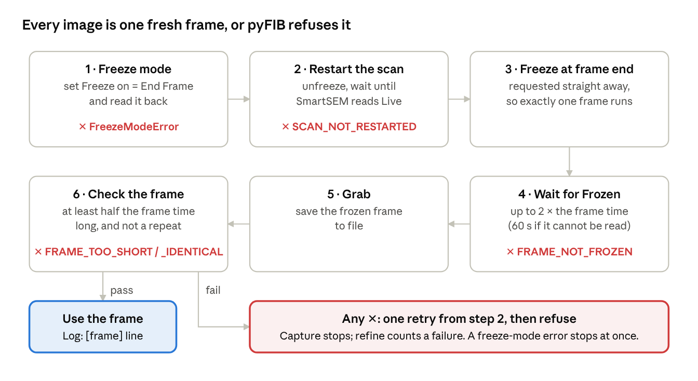

The frame time comes from SmartSEM (AP_FRAME_TIME) and is read again if it grew. The too-short check is skipped for frames under 0.3 s and for reduced-raster autofocus frames. Each frame prints `[frame] speed N, AP_FRAME_TIME x s, Live -> Frozen y s` in the Log; on a good frame y is close to x.

Before any FIB image, pyFIB also makes sure SmartSEM is in FIB imaging. If it was not, it switches, waits at least 0.5 s and until the FIB magnification has been steady for 1 s (at most 5 s), and logs `[fib] switched to FIB imaging (was 'SEM') …`.

## Tools tab

The Tools tab holds three stand-alone jobs: the session report and the two autofocus routines, run at the current position. Unarmed, each only checks and plans; armed, each asks before it starts.

**Session report.** **Standard pattern** is drawn on positions with no milling record and no authored pattern (default: pyFIB's `default.ely`). Tick **Include 800x mosaic** for a quarter-size mosaic of the 800x frames placed by stage position, and **Open when done** to open it in the browser. **Make report** reads files only and never connects to the microscope.

**SEM autofocus.** A two-stage search: a coarse pass at 500x, then a fine pass at **SEM mag** (default 2000x), stepping the SEM working distance (4–8 mm only) and scoring sharpness. It takes about 35–55 s and leaves the scan paused. It never touches contrast, brightness or the stage, and it puts the WD back if it fails.

**FIB autofocus.** Sweeps the FIB objective voltage by **Sweep ±** (default 150 V) around its current value, inside **Objective bounds**, at **FIB mag** (default 2000x), and leaves the column at the sharpest focus. **From last position** fills the bounds from the most recent saved site. It uses the same settings as the AF tick on the milling tabs: frames are taken with the beam shifted 12 µm off the area of interest on a reduced raster, to limit dose on the lamella. If it fails, the starting voltage is restored.

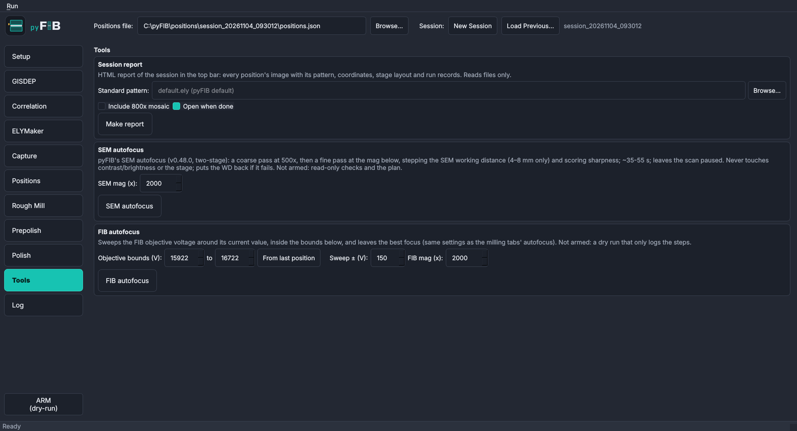

## Reading the Log and the report

Everything pyFIB does is printed to the **Log** tab as it happens; these are the lines worth reading.

| Log line | What it tells you |
| --- | --- |
| `[frame] speed N, AP_FRAME_TIME x s, Live -> Frozen y s` | One fresh frame was taken. y should be close to x. |
| `[fib] switched to FIB imaging (was 'SEM'): … steady for 1 s by +T s` | pyFIB put SmartSEM back into FIB imaging and waited for the magnification to settle. |
| `[tilt] NOT milling <name>: …` | Site left out by the 2° tilt limit. |
| `[stage] NOT milling <name>: …` | Prepolish or Polish site with no previous after image. |
| `[safety] SmartSEM still indicates milling activity …` | pyFIB is waiting before moving the stage. |
| `[confirm] Completion not stable after N s (window 20 s)` | "Finished" flipped back. N must stay well below the window. |
| `*** WARNING: scan rotation differs from capture …` | Milling conditions differ from the capture. Milling continues; check the result. |
| `[i/n] Completed milling at <name>` | Site done. |
| `[i/n] after-mill image: <path>` | After image saved and recorded. |
| `[i/n] FIB beam shift X/Y reset to 0 after <name>.` | Ready for the next site. |

Every armed batch also writes `<session>\runs\run_<time>.json` with what happened at each site.

**The session report** (`report_<time>.html`, from the Tools tab or the command line) shows every position's image with its pattern drawn on it, its coordinates, a stage-layout plot, and for each batch what happened at each site. It then draws the standard pattern with each part's current, depth, width and height. It also writes `report_<time>_positions_map.png/.tif/.json/.csv` for pyCLEM: the positions as dots on a calibrated image (1 µm per pixel), stage X increasing to the left and Y downward, as in the Crossbeam images.

## Command line

Every GUI button runs a `python -m pyfib` command, which you can also type yourself. Without `--arm` each one is a dry run. `S` below stands for your session folder, and `python -m pyfib <command> --help` lists every option.

| Command | What it does |
| --- | --- |
| `ui` | Open the GUI. `--positions-file` opens a given session. |
| `capture-position NAME` | Set FIB magnification, grab the reference frame, record the position. |
| `list-positions` | Print the positions in a file. |
| `goto-position NAME` | Recall a position (stage, optionally `--set-objective`). |
| `mill-positions ELY [NAMES]` | The milling batch (Rough Mill, Prepolish, Polish with `--stage`). |
| `site goto/align/push/after-image NAME` | The four manual buttons. |
| `clem-overview`, `clem-targets`, `clem-markup` | Correlation tab steps. |
| `milling-check` | Read-only: what pyFIB reads as SmartSEM's milling state. Sends nothing. |
| `debug-fib-imaging` | Log FIB/SEM imaging-mode readings to debug switching. |
| `pattern-info ELY` | Summarise an `.ely` file. |

The three milling stages:

```
python -m pyfib mill-positions rough.ely --positions-file S\positions.json --stage rough --refine-all --arm
python -m pyfib mill-positions prepolish.ely --positions-file S\positions.json --stage prepolish --refine-all --arm
python -m pyfib mill-positions polish.ely --positions-file S\positions.json --stage polish --refine-all --arm
```

One site by hand:

```
python -m pyfib site goto position_12 --stage prepolish --positions-file S\positions.json --arm
python -m pyfib site align position_12 --stage prepolish --positions-file S\positions.json --arm
python -m pyfib site push position_12 --stage prepolish --ely prepolish.ely --positions-file S\positions.json --arm
python -m pyfib site after-image position_12 --stage prepolish --positions-file S\positions.json --arm
```

Correlation:

```
python -m pyfib clem-overview --kind fib --grid Grid1 --positions-file S\positions.json --arm
python -m pyfib clem-overview --kind sem --grid Grid1 --mag 200 --positions-file S\positions.json --arm
python -m pyfib clem-targets --positions-file S\positions.json
python -m pyfib clem-markup --positions-file S\positions.json --all --arm
```

The report, which never connects to the microscope:

```
python -m smartfib_executor.report S\positions.json --pattern standard_lamella.ely --mosaic
```

Useful batch options: `--continue-on-error`, `--accept-tilt-skips NAMES`, `--accept-reference-skips NAMES`, `--tilt-check` (read-only tilt list), `--timeout` (milling wait, default 5400 s; 0 = no limit), `--wait auto|mode_change|blanked`.

On the command line refine never moves the stage unless you add `--refine-enable-stage`; the GUI's **Refine may move stage** box is ticked by default and adds it for you.

## Troubleshooting

When pyFIB refuses, it says why in the Log and leaves the instrument as it was. The common messages:

| Message | Meaning | What to do |
| --- | --- | --- |
| `Record after image for <name> refused: SmartSEM indicates milling (or the milling state cannot be read). Nothing was changed.` | A manual button was pressed while SmartFIB was milling, or the state could not be read. | Wait for SmartFIB to finish. `python -m pyfib milling-check` shows what pyFIB reads. |
| RRemoting Error: "Failed to create an instance of Managed… unable to open port for incoming connections" | The SmartSEM Remote API could not open a connection. | Make sure no other program (serialFIB, a second pyFIB command) holds a connection; `test_scripts\api_check.py` lists them. Then retry. |
| `FreezeModeError` | SmartSEM's Freeze-on setting did not read back as End Frame, so a single frame cannot be guaranteed. | Check Freeze on in SmartSEM, then retry. |
| `SCAN_NOT_RESTARTED`, `FRAME_TOO_SHORT`, `FRAME_IDENTICAL`, `FRAME_NOT_FROZEN` | The frame was stale or incomplete (one retry already failed). Capture refuses; refine counts it as a failure. | Check the scan is running and not paused, and the frame time is sensible for the scan speed. Retry. |
| `Low confidence`, `Unreliable`, `Residual`, `Stopped after` (refine) | Refine could not find the site confidently. pyFIB has already tried speed 8 and the 800x frame where allowed. | Look at the site's reference or after image. Use Go to and Align by hand, or re-capture. |
| `tilt guard: <name> is recorded at … limit 2 deg -- not moving` | The site is more than 2° from the live tilt. | Tilt by hand (or via CLEM SAFE) and run that site in its own batch. |
| `Could not load positions: [Errno 2] No such file or directory` | A new session has no file until the first capture. | Nothing; capture a site. |
| `position '<name>' has no fib_pixel_size_m (v1 record?)` | The site was captured by an old version and cannot be authored to scale. | Re-capture it. |
| `No pyMap targets file in this session's clem folder yet.` | pyMap has not written targets for this session. | In pyMap, press Write targets for pyFIB. |
| `A command is already running` | pyFIB runs one command at a time. | Wait for the current command to finish (Log tab). |
| "The command CRASHED (0xC0000005 ACCESS VIOLATION)" | The command died inside native code, e.g. the ZEISS API, possibly in the middle of an action. | Check the microscope in SmartSEM (stage, beam, milling, beam shift) before continuing; send the logs folder. |
| "pyFIB did not close normally last time" (at start-up) | The last run ended without closing: a hard crash, a kill from Task Manager or power loss. The box names the tab and the command that was running, and says if that command is STILL running. | Check the microscope before continuing; send the logs folder. If the logs show nothing, Windows Event Viewer › Windows Logs › Application › "Application Error" for python.exe names the faulting module. |

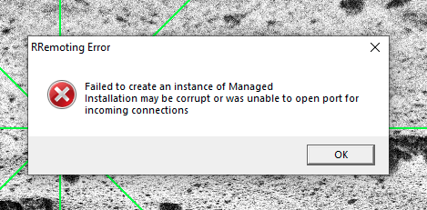

For anything else, send the whole `logs\` folder (**Run › Open logs folder**: `pyfib_gui_errors.log`, `pyfib_faults.log`, `pymap.log`, `pymap_hangs.log`) and the run's `runs\run_<time>.json`.

Step-by-step instrument checks for each feature live in `test_scripts\` (for example `SINGLE_FRAME_TEST.txt`, `MILL_STAGES_TEST.txt`, `CLEM_OVERVIEW_TEST.txt`); `test_scripts\README.txt` lists them.
